# Fleet Monitor

**Demo video (1:54, silent, 1.5× speed):** [docs/media/demo.mp4](docs/media/demo.mp4) — Tarsus operator logs in, live
list, map, vehicle detail, simulator stopped → vehicles go Offline → back Online, API restarted → Reconnecting → recovers.

An operations team monitors remote vehicles from a phone. Vehicles (here: a simulator) push telemetry to a .NET API,
which stores it in PostgreSQL, decides who may see what, detects vehicles that went silent, and pushes changes in real
time over SignalR to a Flutter app. Each user only sees the fleets assigned to them, enforced by the backend for REST
and real-time alike.

Docs: [technical decisions](docs/DECISIONS.md) · [API contract](docs/API.md) · [working spec (CLAUDE.md)](CLAUDE.md) ·
[UI design source](docs/design/fleet-monitor-design/)

## Architecture

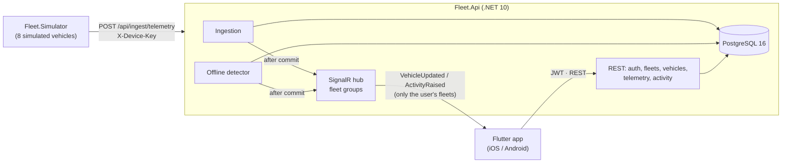

```
backend/   Fleet.Api (API + hub), Fleet.Simulator, Fleet.Api.Tests      docker-compose.yml  (db + api + simulator)
mobile/    fleet_monitor (Flutter app)                                   config/devices.json (demo device keys)
docs/      DECISIONS.md, API.md, design/, media/
```

## Tested with

| Tool | Version |
|---|---|
| Docker / Docker Compose | 28.4 / 2.39 (Docker Desktop, macOS arm64) |
| .NET SDK (only for running backend tests locally) | 10.0.403 (`backend/global.json` allows 10.0.x) |
| Flutter / Dart | 3.44.3 stable / 3.12.2 |
| Xcode / iOS simulator | 27.2 / iPhone 17 Pro, iOS 26 |
| Android | Android SDK 36, emulator `sdk gphone64 arm64`, Android 17 (API 37) |

## Run the backend

```bash
git clone https://github.com/ibrahimbinbuga/baibars-home-assignment.git
```

```bash
cd baibars-home-assignment
```

```bash
docker compose up --build
```

This starts PostgreSQL, the API (applies migrations and seeds demo data on first start) and the vehicle simulator.
Nothing else to install or configure.

| What | URL |
|---|---|
| API | http://localhost:8080 |
| Health | http://localhost:8080/health |
| Swagger UI | http://localhost:8080/swagger |
| PostgreSQL (for inspection) | `localhost:5433`, db `fleet`, user `fleet`, password `fleet_demo_password` (demo-only) |

Data lives in the named volume `pgdata`: `docker compose down` keeps it, `docker compose down -v` deletes it.

## Run the mobile app

Start the backend first. Then, from `mobile/fleet_monitor`:

```bash
cd mobile/fleet_monitor
```

```bash
flutter pub get
```

**iOS simulator** (boot one first, e.g. `open -a Simulator`; `flutter devices` shows its id):

```bash
flutter run -d <ios-simulator-id> --dart-define=API_BASE_URL=http://localhost:8080
```

**Android emulator** (start one first, e.g. from Android Studio's Device Manager):

```bash
flutter run -d emulator-5554 --dart-define=API_BASE_URL=http://10.0.2.2:8080
```

`API_BASE_URL` is required; without it the app shows a configuration error instead of starting.
`10.0.2.2` is how the Android emulator reaches the host machine.

## Demo accounts

Demo-only passwords, created by the seeder; never use them anywhere else.

| Email | Password | Role | Sees |
|---|---|---|---|
| `admin@demo.local` | `Admin123!` | Admin | both fleets (8 vehicles) |
| `tarsus.operator@demo.local` | `Operator123!` | Operator | Tarsus Field Ops (TR-01…TR-04) |
| `adana.operator@demo.local` | `Operator123!` | Operator | Adana Field Ops (AD-01…AD-04) |

## Run the tests

**Backend** (Docker must be running: the tests start a real PostgreSQL with Testcontainers):

```bash
cd backend && dotnet test
```

**Mobile:**

```bash
cd mobile/fleet_monitor && flutter test
```

```bash
cd mobile/fleet_monitor && flutter analyze
```

At the time of writing: 112 backend tests, 108 mobile tests, analyzer clean.

## Demo scenarios

1. **Access control in the app.** Log in as `tarsus.operator@demo.local` → only TR-01…TR-04 are listed and on the map.
2. **Access control in the API.** Ask for an Adana vehicle with the Tarsus operator's token → `404` (the same answer
   as for a vehicle that doesn't exist, so nothing leaks):

   ```bash
   login() { curl -s -X POST http://localhost:8080/api/auth/login -H 'Content-Type: application/json' -d "{\"email\":\"$1\",\"password\":\"$2\"}" | python3 -c 'import sys,json;print(json.load(sys.stdin)["accessToken"])'; }
   ```

   ```bash
   TARSUS=$(login tarsus.operator@demo.local 'Operator123!'); ADMIN=$(login admin@demo.local 'Admin123!')
   ```

   ```bash
   ADANA_ID=$(curl -s http://localhost:8080/api/vehicles -H "Authorization: Bearer $ADMIN" | python3 -c 'import sys,json;print([v["id"] for v in json.load(sys.stdin) if v["fleetName"]=="Adana Field Ops"][0])')
   ```

   ```bash
   curl -i http://localhost:8080/api/vehicles/$ADANA_ID -H "Authorization: Bearer $TARSUS"
   ```

3. **Live updates.** Watch vehicles move and change state without refreshing; open a vehicle and watch activity
   events (state changes, faults, low battery) appear at the top.
4. **Offline detection.** Stop the simulator → within ~35 s every vehicle turns Offline (live); start it → back Online:

   ```bash
   docker compose stop simulator
   ```

   ```bash
   docker compose start simulator
   ```

   (Vehicle SN-0004 also drops out for 45 s every 3 minutes on its own.)
5. **Connection loss.** Restart the API → the app shows "Reconnecting…", then recovers by itself with fresh data and
   nothing lost. Stop it for longer (~1 min) → "Disconnected" with Retry; start it and tap Retry:

   ```bash
   docker compose restart api
   ```

   ```bash
   docker compose stop api
   ```

   ```bash
   docker compose start api
   ```

## Screenshots

| Login | Vehicles (list) | Map | Map: vehicle selected |
|---|---|---|---|
| 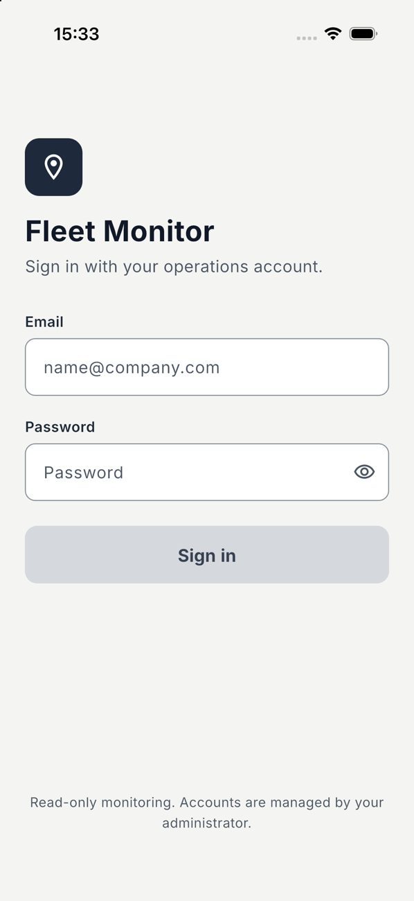 | 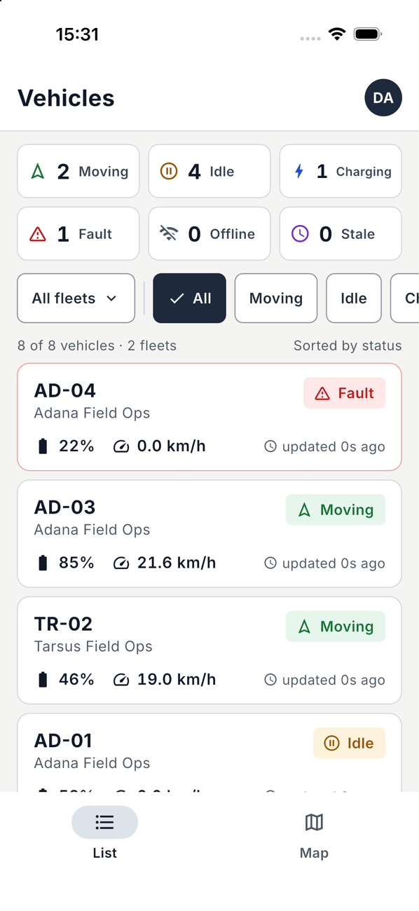 | 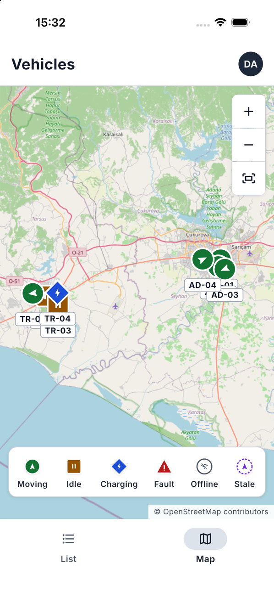 | 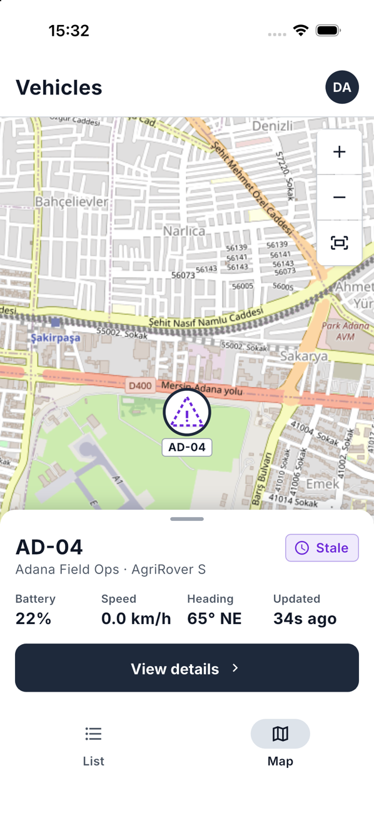 |

| Detail: activity | Detail: history | Account | Login: validation |
|---|---|---|---|
| 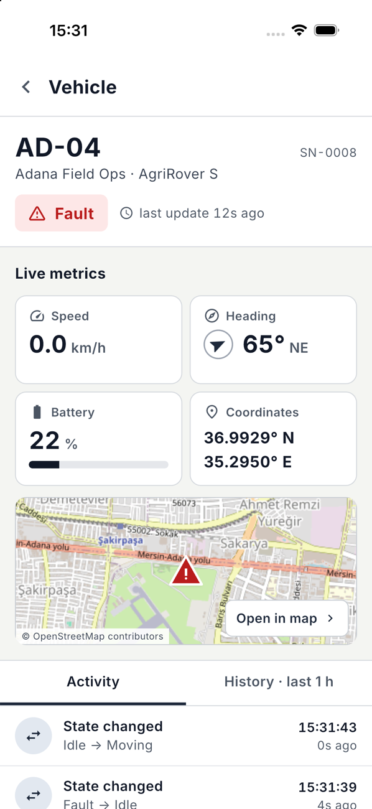 | 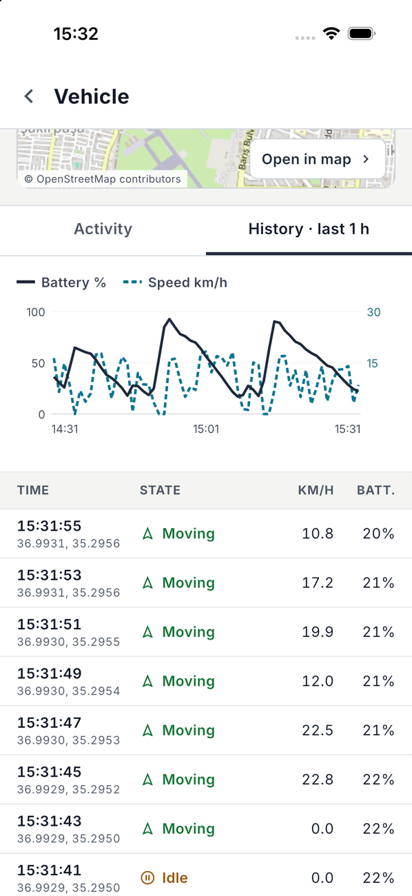 | 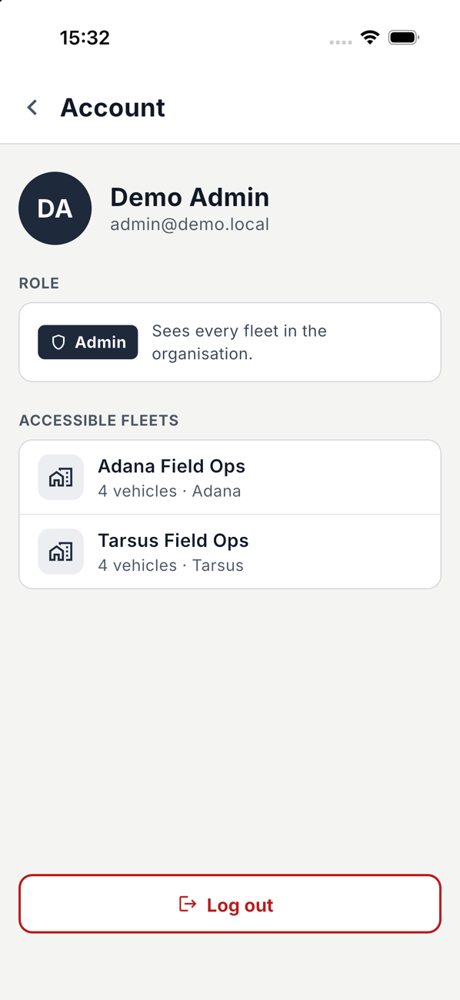 | 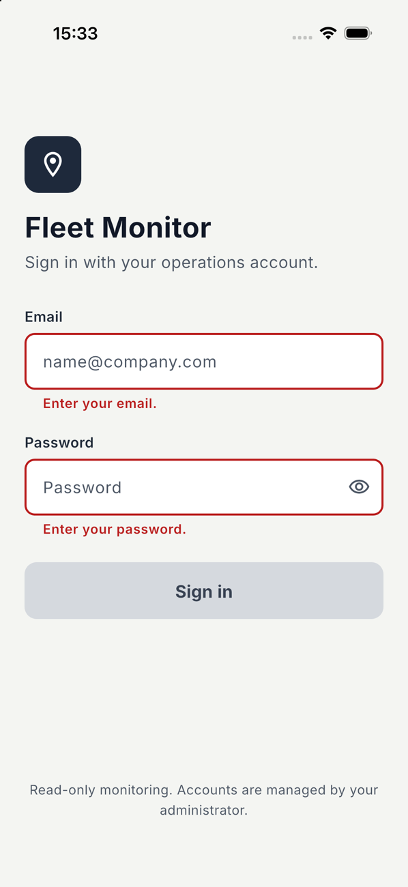 |

| Reconnecting (iOS) | Disconnected (iOS) | Reconnecting (Android) | Disconnected (Android) |
|---|---|---|---|
| 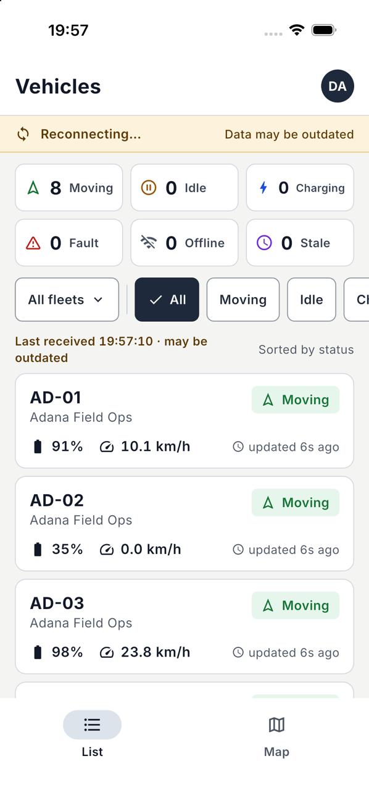 | 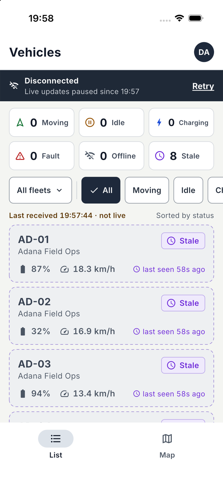 | 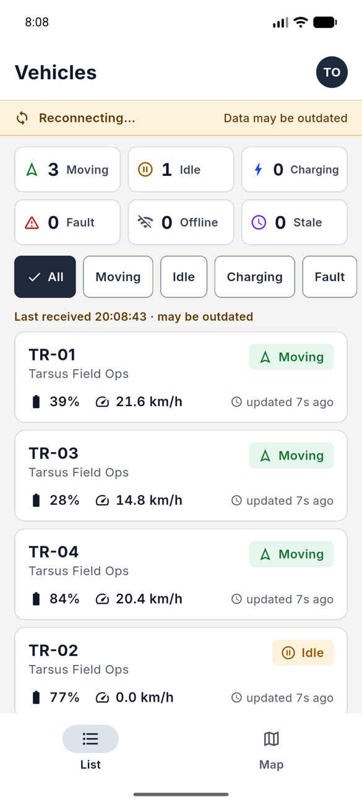 | 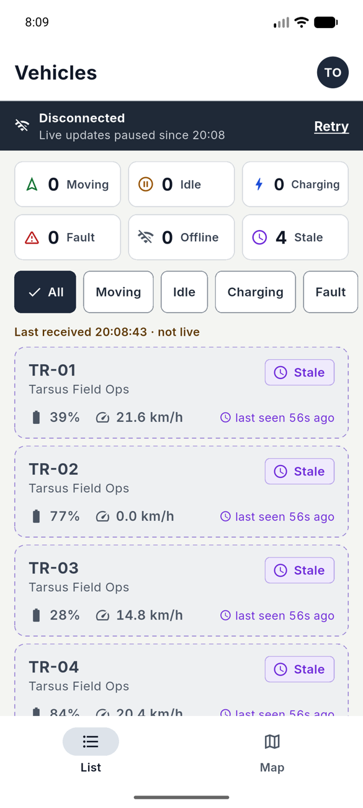 |

| Android: list (operator) | Android: map | Android: wrong password |
|---|---|---|
| 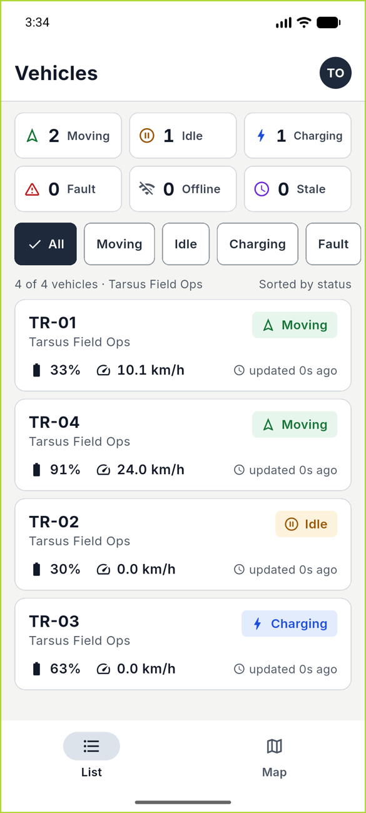 | 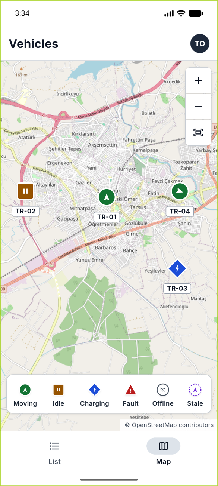 | 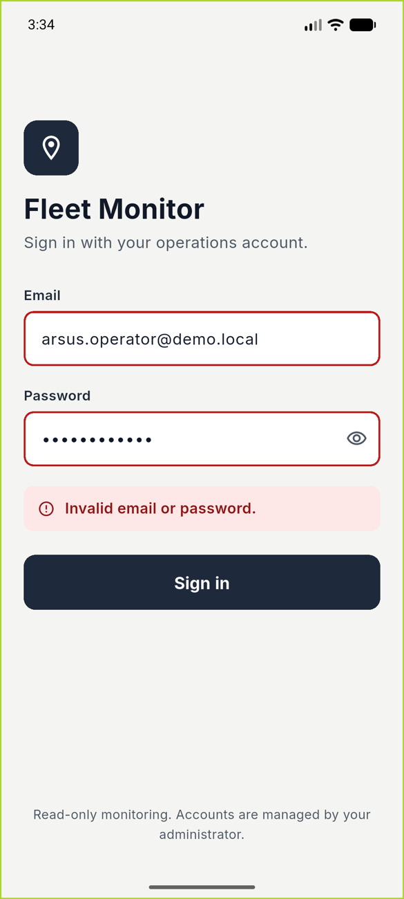 |

## What was verified, and where

- Backend: automated tests against a real PostgreSQL (access rules on every endpoint, ingestion rules, idempotency,
  offline detection with a fake clock, hub group isolation, token expiry closing the hub, rate limiting).
- Mobile: unit and widget tests (models, API client, auth, list ordering, real-time controller with a fake connection,
  screens with fake repositories).
- End to end against `docker compose` on **both the iOS simulator and the Android emulator**: login, fleet scoping,
  live updates, offline detection (~33 s), API restart (Reconnecting → recovers), API down (Disconnected → Retry),
  backgrounding and resuming, session restore and logout.

## Known issues

- **`flutter build ios --simulator` fails with Flutter 3.44.3 + Xcode 27.2.** Flutter's framework check calls
  `lipo -verify_arch x86_64 arm64`, which Xcode 27's `lipo` no longer accepts. Use `flutter run -d <simulator>` as
  above (it builds only the simulator's architecture). Not a project issue.
- **A physical phone on the LAN won't connect as is.** Plain HTTP is allowed only to `localhost` (iOS) and
  `localhost`/`10.0.2.2` (Android); everything else requires HTTPS. A real device needs the API behind HTTPS (or an
  added exception for your machine's address).
- **`config/devices.json` contains demo-only device keys, committed on purpose** so `docker compose up` works from a
  clean clone. In production each device is provisioned individually and keys never live in the repository. The JWT
  signing key and database password in `docker-compose.yml` are demo-only too.
- **Map tiles come from OpenStreetMap's public servers**, which is fine for a demo only (their usage policy doesn't
  allow heavy or commercial use).

More limitations and what I'd do next: [docs/DECISIONS.md](docs/DECISIONS.md).

## Configuration

Set as environment variables in `docker-compose.yml` (double underscore = nested key), or in
`backend/src/Fleet.Api/appsettings*.json` for `dotnet run`.

| Key | Default | Meaning |
|---|---|---|
| `ConnectionStrings__Fleet` | — (required) | PostgreSQL connection string |
| `Jwt__SigningKey` | — (required, ≥ 32 bytes) | HS256 key for user tokens (60 min) |
| `Seed__Enabled` / `Seed__DevicesFile` | `false` / — | Seed demo users, fleets, vehicles from `devices.json` |
| `Swagger__Enabled` | `false` | Serve OpenAPI + Swagger UI |
| `Telemetry__OfflineThresholdSeconds` | `30` | Silence before a vehicle is Offline (checked every 5 s) |
| `RateLimiting__Login__PermitLimit` / `__WindowSeconds` | `5` / `60` | Login attempts per IP per window |
| `Simulator__IntervalSeconds` | `2` | Seconds between samples per simulated vehicle |

The API refuses to start with missing or invalid settings (e.g. a signing key shorter than 32 bytes).

## How this was built

AI-assisted with Claude Code. [CLAUDE.md](CLAUDE.md) is the working specification; the work was done phase by phase
(scaffolding → data & auth → vehicles API & access control → ingestion & simulator → real-time hub → mobile foundation →
designed UI → real-time & connectivity → docs), and every phase was reviewed, discussed and verified (tests plus manual
checks against the running system) before moving on. Decisions made along the way are recorded in
[docs/DECISIONS.md](docs/DECISIONS.md).
