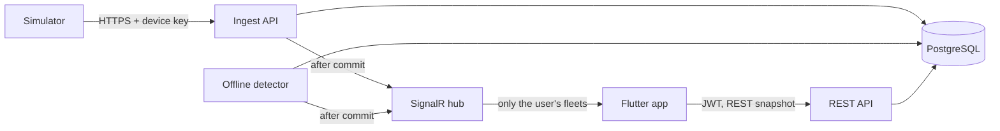

# Technical decisions

The four questions from the assignment, answered briefly. Detailed notes on individual decisions are in the
[appendix](#appendix-detailed-decision-notes).

## 1. What would I ideally clarify?

- **Who sees what:** is access granted per fleet, per vehicle, or per site/customer? Are there roles beyond "admin
  sees all, operator sees assigned fleets" (e.g. read-only vs. can acknowledge alarms)?
- **Identity:** is there an existing identity provider / SSO (Azure AD, Google Workspace, Keycloak) the app should use?
- **How vehicles connect today:** protocol (HTTPS, MQTT, a vendor gateway), how often they report, network quality in
  the field (gaps, buffering), and whether they have reliable clocks.
- **What "offline" means operationally:** after how long without data, and should someone be alerted?
- **Latency expectations:** is a few seconds fine, or is near-instant required?
- **History:** how far back must history go, and are there retention or compliance rules for location data?
- **Commands:** monitoring only, or will operators later send commands to vehicles (stop, return home)?
- **Platforms and scale:** which phones/OS versions the team uses, how many vehicles and users to expect.
- **Notifications:** do operators need push notifications for faults/low battery while the app is closed?

## 2. Assumptions (and why)

| # | Assumption | Why | If it's wrong |
|---|---|---|---|
| A1 | Access is per **fleet** | Matches how field teams are organised; one rule to enforce | Swap the `UserFleetAccess` table for per-vehicle access; `IVehicleAccessService` stays the single place to change |
| A2 | Two roles: Admin sees all, Operator sees assigned fleets; both **read-only** | Simplest model that shows real access control | Add roles/permissions to the token and the access service |
| A3 | Tens of vehicles, one sample every ~2 s each | Typical small operation; easy to demo | For thousands: batch ingestion, partition telemetry, SignalR backplane |
| A4 | Monitoring only, no commands | The assignment asks for monitoring | Add a command channel (likely MQTT) and an audit trail |
| A5 | Offline = no data for **30 s**, decided by the server | One authoritative rule for every client | Change `Telemetry:OfflineThresholdSeconds` |
| A6 | "Previous activity" = telemetry history + activity events | Covers both "where/how was it" and "what happened" | Add the missing event types |
| A7 | History kept indefinitely | Fine for a demo | Retention job / time partitioning |
| A8 | Vehicles push over HTTPS with a per-vehicle key | Simple, testable, works through most networks | MQTT broker in front, same ingestion service behind it |
| A9 | No offline cache in the app; clear stale/disconnected states instead | Monitoring data is only useful when current | Cache the last snapshot locally |
| A10 | A vehicle outside your fleets answers **404**, not 403 | Doesn't reveal that it exists | Change one line if the client prefers 403 |

## 3. Main components and why

- **One ASP.NET Core API project, organised by feature folders.** The domain is small; extra layers/projects would add
  indirection without making it more testable (the integration tests run the real HTTP pipeline anyway).
- **PostgreSQL** for everything: relational data, telemetry history and the latest state. Durable across restarts,
  real transactions, and the unique index on (vehicle, sequence) makes ingestion idempotent.
- **Latest state on the vehicle row + a separate history table.** The list and map read one row per vehicle;
  history queries use an index. Late samples go to history without overwriting the latest state.
- **SignalR for real time** instead of polling (wasteful, slow), plain SSE (no built-in groups/reconnect in .NET +
  Flutter) or MQTT to the phone (another broker and auth system). It works over WebSockets with fallbacks and reconnects.
- **Server-side groups per fleet.** The server puts each connection in its fleets' groups from the same access rule as
  REST; there is no way for a client to subscribe to another fleet.
- **Every change is broadcast only after the database commit**, and the app orders updates per vehicle by a server
  `updatedAt`, so a late REST snapshot can't undo a newer live update.
- **The simulator is a separate process** that calls the same ingest endpoint a real vehicle would; stopping it
  demonstrates offline detection.
- **Flutter + Riverpod** for one codebase on iOS and Android with simple, testable state.

## 4. What I left out or simplified

| Left out | How I'd do it with more time |
|---|---|
| Commands to vehicles | Command endpoint + MQTT/command queue to devices, with acknowledgements and an audit log |
| Refresh tokens | Short access token + rotating refresh token; the app refreshes silently instead of logging out after 60 min |
| User / fleet management UI | Admin screens or reuse the company's identity provider and its groups |
| Push notifications | FCM/APNs for faults and low battery, triggered by the same activity events |
| Offline cache in the app | Store the last snapshot locally and show it, clearly marked as old |
| Telemetry retention / partitioning | Time-partitioned table (or TimescaleDB), downsample old data, drop after N days |
| Horizontal scaling | Several API instances behind a load balancer + SignalR backplane (e.g. Redis); migrations as a deploy step |
| HTTPS / TLS | Terminate TLS at a reverse proxy / ingress; HSTS; no cleartext exceptions in the app |
| Rate limiting beyond login | Per-device limits on ingest, per-user limits on the API, behind the proxy with forwarded IPs |
| Device provisioning | Per-device keys issued at manufacturing/onboarding, rotation and revocation, stored in a secret store |
| Map tiles | Commercial or self-hosted tile provider, URL in config, tile caching |

## Known limitations / incomplete

- **Clock-based states depend on the phone's clock.** "Stale" and the session-expiry timer use the device time;
  a badly wrong clock shows vehicles stale too early/late (the server's Offline status is not affected).
- **Open real-time connections keep their groups.** REST checks the user and their current role on every request,
  but a hub connection's fleet groups are decided when it connects: a removed fleet or a changed role applies to it on
  the next (re)connect, and a **deleted user's already-open connection stays open until the token expires**
  (≤ 60 min). New connections of a deleted user are rejected.
- **iOS keeps Keychain items when the app is uninstalled**, so a reinstalled app can start with an old token. That
  token is accepted only if its user still exists; otherwise the first request gets 401 and the app shows login.
- **Single API instance.** No SignalR backplane; startup migrations and seeding would race with several instances.
- **History list shows every sample** of the last hour (~1800 rows); the chart averages per minute. No live append.
- **A detail screen opened for a vehicle not in the list** (rare fallback path) doesn't update live.
- **Rate-limit countdown is an upper bound** (the limiter reports its full window, not the time left).
- **Mobile verified on simulators/emulators only** (iOS simulator and Android emulator), not on physical devices; a
  physical device needs the API behind HTTPS.
- **OSM public tiles** are for the demo only.
- **No load or soak testing**; scale claims are assumptions (A3).

---

## Appendix: detailed decision notes

Notes written while building, grouped by area. Decision first, then why.

### Hosting & configuration
- **No HTTPS inside the container.** The API listens on plain HTTP 8080 and has no `UseHttpsRedirection`/HSTS.
  In production TLS is terminated by a reverse proxy / load balancer in front of the API.
- **Compose runs as `Production`, demo features are flags.** `ASPNETCORE_ENVIRONMENT=Production` means no developer
  exception page (no stack traces to clients). Swagger and seeding are turned on with explicit flags
  (`Swagger:Enabled`, `Seed:Enabled`), off by default in `appsettings.json`.
- **Demo secrets in compose.** The JWT signing key, DB password and device keys in `docker-compose.yml` /
  `config/devices.json` are demo-only. Production would use a secret store (e.g. environment from a vault).
- **Fail fast on bad config.** Options are validated at startup (`ValidateOnStart`): e.g. a JWT signing key shorter
  than 32 bytes (HS256 minimum) stops the app instead of issuing weak tokens.
- **`GSS Encryption Mode=Disable` in every connection string.** Npgsql otherwise tries to load the Kerberos library
  (`libgssapi_krb5`), which the `aspnet` image doesn't ship, and logs a harmless but alarming error. We don't use
  Kerberos, so turning it off is cleaner than installing a library we don't need.
- **Postgres published on host port 5433** so `dotnet run` (appsettings.Development) can use the compose database
  without clashing with a local Postgres on 5432.

### Data
- **Migrations at startup** (hosted service, before the server accepts requests). Fine for a single instance.
  With several instances they would race to apply the same migration; production would run migrations as a
  separate deploy step (EF migration bundle / pipeline job). The seeder has the same race: two instances could both
  see "no users" and the second would fail on the unique email index. Seeding would also move to that one-off step
  (and in production there is no demo seed at all).
- **Enums stored as text** so the database is readable without the code.
- **`xmin` as concurrency token on `Vehicle`** (Postgres system column, no extra column).
- **Seeder is idempotent** (skips if any user exists) and writes everything in one `SaveChanges` (one transaction).
- **Entity named `VehicleFleet`**, not `Fleet`: a type named `Fleet` clashes with the root namespace `Fleet`.
  Table and API still say "fleet".
- **Single `config/devices.json`** is the source for both the seeder (stores hashes) and the simulator (sends keys).
- **`config/devices.json` contains demo-only device keys, committed on purpose** so `docker compose up` works from a
  clean clone. In production each device is provisioned individually and keys never live in the repo.

### Auth
- **Device keys hashed with SHA-256 (unique index), not BCrypt.** Device keys are 256-bit random secrets, not
  human passwords, so brute force is not realistic and a slow salted hash adds nothing. A deterministic hash lets
  ingestion find the vehicle from the key with one indexed lookup; a salted hash cannot be looked up, and BCrypt
  would cost ~100 ms on every telemetry sample.
- **User passwords hashed with BCrypt** (work factor 11).
- **Login does not reveal whether an email exists**: same 401 body for both cases, and an unknown email still runs
  one `BCrypt.Verify` against a dummy hash so response time is similar.
- **Email normalized** (trim + lowercase) on login and when stored.
- **JWT claims kept short** (`MapInboundClaims = false`): `sub`, `email`, `role` as in the token.
- **A valid token is not enough: the user must still exist, and the role comes from the database.** After the JWT is
  validated (`OnTokenValidated`), the user is loaded by `sub` (one primary-key query, no tracking). A deleted user gets
  401 on the next request (also a deleted admin, whose token still says "Admin"), and the role claim is replaced with
  the current database role, so promoting/demoting someone applies on their next request without a new login. Cost:
  one primary-key lookup per request and per hub connection. Found by the clean-clone check: a token from an earlier
  database (same demo signing key) was still accepted and returned empty data instead of 401.
- **Fallback authorization policy**: every endpoint requires a logged-in user unless marked `[AllowAnonymous]`
  (login, `/health`, OpenAPI document). A new endpoint can't be exposed by forgetting an attribute.
- **Login rate limit**: built-in ASP.NET Core rate limiter, fixed window per client IP, on `POST /api/auth/login`
  only (`RateLimiting:Login:*`, default 5 per 60 s), 429 as ProblemDetails.
  Behind a reverse proxy the client IP would come from `X-Forwarded-For` (`UseForwardedHeaders` with the proxy
  configured as trusted); without that, every client would share the proxy's IP and one limit.

### Vehicles API
- **Access check lives in one place.** `VehicleQueryService` starts every vehicle query from
  `IVehicleAccessService.ScopeVehicles`; controllers never filter. Out of scope and nonexistent give the same 404
  (A10). A `fleetId` filter is applied *after* scoping, so an out-of-scope fleet returns `200 []` and can't be used
  to probe which fleets exist.
- **One status expression.** `VehicleProjections.ToDto` is the only place the user-facing status is derived. The
  `?status=` filter runs on the projected DTO (EF translates a filter after a member-init projection), so the list and
  the filter can't disagree.
- **Read queries project straight to DTOs** (`AsNoTracking` + `Select`): one SQL statement per request, `fleetName`
  via a join, no `Include`.
- **Telemetry window capped at 7 days** (400 above that) and `limit` clamped to 2000: bounds the cost of one request.
  `limit < 1` is a 400 rather than silently becoming 1.
- **Activity uses keyset pagination with an opaque cursor** over (`OccurredAt`, `Id`), not offset paging (stable while
  new events arrive) and not a bare timestamp (events created in one ingestion share a timestamp and would be skipped
  at page boundaries). The cursor truncates to microseconds, Postgres' `timestamptz` precision, so it compares equal
  to stored values. It is not signed: a modified cursor can only move within the caller's own scoped data, and a
  malformed one is a 400.
- **Timestamps from query strings are converted to UTC** before querying (Npgsql only accepts UTC for `timestamptz`).

### Ingestion & offline detection
- **Duplicates: `INSERT … ON CONFLICT ("VehicleId", "Sequence") DO NOTHING`, not catching error 23505.** A repeated
  sample is a normal event (device retries after a timeout), not an error. With `ON CONFLICT` a duplicate is just
  "0 rows inserted": no exception, Postgres logs no `ERROR` line per duplicate, and the transaction stays usable, so
  the code is a straight line. It is still race-safe (the unique index decides). Cost: one hand-written SQL statement,
  kept in one method and covered by the duplicate tests.
- **Device authentication is its own scheme** (`DeviceKey` authentication handler) next to JWT. User tokens can't
  ingest; device keys can't read user endpoints; the vehicle id comes only from the key.
- **One transaction per sample**, `xmin` as optimistic concurrency token on the vehicle row. On a conflict the whole
  attempt is rolled back, the vehicle is re-read and the attempt is retried once; a second conflict returns 503 and the
  device retries the same sample (idempotent by sequence). Conflicts are rare (one sender per vehicle); the realistic
  source is the offline detector writing the same row.
- **Offline detection vs. ingestion race.** The detector reads stale vehicles, then writes each one with the `xmin` it
  read. If a sample arrived in between, the row changed, the update matches nothing, and that vehicle is skipped:
  it just reported in. Each vehicle is its own `SaveChanges`, so one conflict doesn't undo the others.
- **Offline window 30–35 s**: threshold 30 s, check every 5 s. A shorter interval tightens the window at the cost of
  more queries (one indexed query per pass).
- **Broadcasts only after commit**, never inside the transaction, so clients never see data that might be rolled back.
  The pushed `VehicleDto` is re-read with the same projection as `GET /vehicles/{id}`. A failed broadcast is logged
  and not retried: the data is safe, and clients re-fetch the snapshot on reconnect.
- **Event rules**: `FaultRaised` only when entering Fault (a 20 s fault = 1 event, not 10); no `StateChanged` on the
  first sample (`CameOnline` covers it); `LowBattery` on crossing below 20 %, re-armed after recovering.
- **All event timestamps are server time.** Device clocks drift; one clock keeps the activity order and the cursor
  consistent. The device time is kept in `TelemetryRecord.RecordedAt`.
- **Clock-skew guard**: `recordedAt` more than 5 min in the future is rejected, otherwise a device with a fast clock
  would block newer real samples from becoming the latest state.

### Simulator
- **Separate process calling the real ingest endpoint** with each vehicle's key, so it exercises the same path a real
  vehicle would; stopping it demonstrates offline detection.
- **Sequence starts at the current Unix time in ms**, +1 per sample. A real device keeps its counter in flash; with an
  in-memory counter starting at 1, a restarted simulator would only send duplicates and vehicles would never come back
  Online.
- **Plain `HttpClient` with a manual retry loop** (1, 2, 4, 8, max 10 s) for network errors, 5xx and 429, resending the
  same sample. No resilience library: the logic is ~20 lines and easy to read.
- **Options validated with `Validator.TryValidateObject`** instead of `ValidateDataAnnotations()`, which would need one
  more package in the simulator.
- **`SN-0004` drops out for 45 s every 3 minutes** to show offline detection without touching Docker.

### Logging
- Single-line console logs with timestamps, so `docker compose logs -f` is readable.
- API: per-sample ingestion at Debug; activity events (CameOnline/WentOffline/StateChanged/…) at Information;
  503 after retries at Warning. EF Core and ASP.NET Core framework logs at Warning (migrations at Information).
- Simulator: each send at Debug; startup, state changes, dropout start/end at Information; retries at Warning;
  rejected samples at Error.

### Ordering updates on the client
- **`Vehicle.UpdatedAt` (server time) is the per-vehicle ordering key**, set on every write to the vehicle row
  (ingestion and offline detection) and exposed as `updatedAt` on REST and the hub. `lastTelemetryAt` doesn't work:
  going Offline doesn't change it, and a REST snapshot read *before* the Offline flip but arriving *after* the live
  Offline update would have the same `lastTelemetryAt` and flip the vehicle back to Online.
- **Strictly increasing per vehicle**: truncated to microseconds (Postgres precision, so clients compare exactly what
  is stored) and at least 1 µs after the previous value, even within one microsecond or if the clock steps back.
  The `xmin` token already serializes writers per vehicle, so "previous" is always the committed value.
- Clients keep the copy with the greater `updatedAt` and ignore equal or older ones, for live updates and REST
  snapshots alike.

### Real-time (SignalR hub)
- **Strongly typed hub (`Hub<IFleetClient>`) with no client → server methods.** Group membership is decided in
  `OnConnectedAsync` from `IVehicleAccessService`, the same rule as REST. A client cannot ask to join a fleet, so the
  real-time channel can't leak data across fleets. Group membership is fixed for the life of a connection: access
  changes apply on the next (re)connect, and a deleted user's open connection lasts until token expiry (acceptable
  for the demo; production would remove the user from groups / abort their connections when access is revoked).
  Connecting runs the same user check as REST, so a deleted user can't open a new connection.
- **Sends go to `fleet:{fleetId}` groups only**, through `IHubContext<FleetHub, IFleetClient>` behind
  `IFleetBroadcaster`, after commit.
- **Same JSON settings for REST and SignalR** (`JsonConfiguration.Apply`), so the app parses one `VehicleDto` shape.
- **Hub accepts only the JWT scheme.** Device keys can't connect.
- **`access_token` query parameter accepted only on `/hubs/fleet`.** WebSocket clients can't always set headers; on
  every other path a token in the URL is ignored, so tokens don't spread into URLs.
- **Tokens in the hub URL are not logged.** Checked: ASP.NET Core request logs (which include the query string) are
  at Information, and the `Microsoft.AspNetCore` category is configured at Warning; SignalR/connection/Kestrel logs
  that mention connections are Debug/Trace. After a WebSocket session on compose, the API logs contained no
  `access_token`, `/hubs/` or JWT text. If request logging is ever turned on, the query string must be redacted
  first. A reverse proxy in front would need the same care.
- **`CloseOnAuthenticationExpiration = true`.** Without it an open connection keeps receiving data after the JWT
  expires. It closes at the token's `exp`: JwtBearer copies `exp` into the authentication properties and the
  connection layer checks it about once per second. `ClockSkew` (30 s) only applies when a token is validated, so it
  does not extend an open connection (a test with a 3 s token closes in ~5 s, well under the skew). The app then has
  to log in again (no refresh tokens) and reconnect.
- **Tests use long polling** through the in-memory TestServer (WebSockets there need extra setup). Negotiate, auth,
  groups and the JSON protocol are the same; the compose smoke test covered real WebSockets.

### Mobile app (foundation)
- **Riverpod 3 without code generation**, plain `Notifier`/`AsyncNotifier`/`Provider`. Automatic provider retry is
  turned off: errors are shown with an explicit retry, and retrying a 401/404 only repeats the failure.
- **No router package.** The home screen follows the auth state (login vs. app), so any logout lands on login.
  Revisit if the 5b design needs deep links or nested navigation.
- **One `ApiClient` (dio)** that adds the token and turns every failure into a typed `ApiException` built from the
  server's ProblemDetails. A 401 logs out, **except on `POST /api/auth/login`**, where 401 means wrong credentials and
  429 means rate-limited.
- **Session in secure storage** (Keychain / Android Keystore via `flutter_secure_storage`): token, `expiresAt` and the
  user. The app restores without a network call; an expired token on start goes to login with "session expired",
  and a timer logs out when `expiresAt` passes while the app is open. Relies on the device clock (the server's
  30 s skew covers small drift; a badly wrong clock just causes an earlier/later logout).
- **Unknown enum values never crash**: status, connectivity, state, activity type and role have an explicit `unknown`,
  so a newer API can add values without breaking older app versions.
- **Client-side filtering over the full list**: the list state holds every vehicle the user can see (already scoped by
  the server), filters are a view on top. Live updates can then always be applied by id. Server-side filter params
  are still available in the repository.
- **Ordering by `updatedAt`** (see "Ordering updates on the client"): live updates and REST snapshots both keep the
  strictly newer copy per vehicle. A snapshot decides which vehicles are listed.
- **Cleartext HTTP only for dev hosts**: Android `network_security_config` allows it only for `10.0.2.2` and
  `localhost` (everything else HTTPS-only); iOS uses `NSAllowsLocalNetworking`, which allows plain HTTP to local
  addresses only. A production build would use an HTTPS API and need neither.
- **iOS deployment target 15.0** (template had 13.0, which Xcode 27 rejects).

### Mobile UI (Phase 5b, design in docs/design/)
- **Theme from the design tokens**: Material 3 `ColorScheme` with an ink primary (status colours own the colour
  channel), a `StatusColors` ThemeExtension (foreground + tint per status, incl. stale), the Inter type scale, spacing
  and radius constants. Every status is colour + icon + label, never colour alone.
- **Inter bundled as a font asset** (OFL 1.1, official rsms/inter v4.1 static TTFs) instead of `google_fonts`: no
  runtime download, works offline, and the app doesn't contact Google on start. Tabular figures for all live values.
- **Built-in Material icons** instead of the design's SVG paths: no SVG/path package; close but not identical.
  Map markers are CustomPainter shapes (circle / rounded square / diamond / triangle) so status reads without colour.
- **"Stale" is computed on the client**: online but `lastSeenAt` older than 30 s (the server's offline threshold).
  The server's status stays authoritative; stale only covers the gap before its Offline message arrives. In 5b
  (REST only, no live updates) a snapshot older than 30 s therefore shows as stale until refreshed — intended; Phase 6
  adds live updates and a periodic re-check.
- **Filters on the device over the full scoped list**; the summary counts follow the fleet filter only (status filter
  doesn't change them), as in the design. Sorted Fault → Moving → Idle → Charging → Stale → Offline (reported first),
  then name.
- **Detail reads the vehicle from the shared list state** (falls back to `GET /vehicles/{id}`), so list and detail
  always agree and Phase 6 updates reach both.
- **"Open in map" switches to the app's own Map tab** with the vehicle selected and centred (no external maps app).
  Tapping a marker only selects it (no camera jump); only an external selection moves the camera.
- **History**: the list shows every sample (~1800 per hour) with gap rows where the vehicle was offline (> 30 s
  without samples). The chart is a CustomPainter (no chart package) and plots per-minute averages, because raw 2 s
  samples are too noisy to read; lines break at offline gaps.
- **Rate-limit countdown** from the `Retry-After` header (fallback 60 s). The fixed-window limiter reports the full
  window length, so the countdown is an upper bound, never too short.
- **OSM public tile servers are for the demo only.** Their usage policy doesn't allow heavy or commercial use. The app
  identifies itself (`userAgentPackageName`) and shows the attribution. Production would use a commercial or
  self-hosted tile provider, with the tile URL in configuration.
- **Login validates empty fields on the client** (button disabled until both have text; keyboard submit shows
  "Enter your email/password"), so the server's generic validation message never shows.
- **No app version on Account** (would need `package_info_plus`).
- **Screenshots** in `docs/media/` (iOS simulator full set; Android list, map, login error; Reconnecting and
  Disconnected banners on both platforms).

### Mobile real-time (Phase 6)
- **`RealtimeConnection` interface** over `signalr_netcore`, so the controller is tested with a fake. One connection
  object per attempt: after it closes, a new one is created.
- **Connect the hub first, then fetch the REST snapshot** (and merge it with the `updatedAt` rule) — on start, after
  every automatic reconnect and after resume. Fetching first would lose updates that happen between the snapshot and
  the connection. The app still does a fast first fetch when it opens (to show something immediately); the
  fetch-after-connect is the authoritative one.
- **Reconnect**: the package's automatic reconnect (0, 2, 5, 10, 30 s) after a drop, then our own retry every 30 s
  once the connection has closed (the package doesn't retry a failed first start at all). Banner: nothing while the
  first attempt runs or after an intentional pause; "Reconnecting…" during the automatic reconnect or a manual
  Retry; "Disconnected – paused since HH:mm" + Retry once it closed. The count line shows "Last received HH:mm:ss ·
  may be outdated / not live" in amber while not live.
- **Guards**: one connection attempt at a time; the 30 s loop only after close, never during the automatic
  reconnect; logout and pause cancel the timer and invalidate the connection; every callback checks a generation
  number, so late events from an old or stopped connection are ignored; a refresh started just before logout does
  not fetch afterwards. The old connection is stopped without being awaited, so a slow stop can't delay anything.
- **Session expiry vs. network loss**: if the hub closes and the token is expired (the server closes it at `exp`),
  the app logs out with "session expired" instead of showing Disconnected. On resume the expiry is checked first,
  because timers don't run while the app is suspended.
- **Lifecycle**: background → connection and ticker stopped on purpose (no banner, no retries); foreground →
  reconnect, then re-fetch.
- **Live activity**: `ActivityRaised` is added to an open activity feed for that vehicle, deduplicated by event id;
  events arriving while the first page is loading are merged in afterwards. **The History tab doesn't append live**
  (pull to refresh / reopening is enough for a 1-hour history; ~1800 rows would churn constantly).
- **1 s ticker**: only small widgets (`TimeAgoText`, the card's accessibility label) rebuild every second. Screens
  watch the *set of stale vehicles*, which only changes when a vehicle crosses the 30 s line, so the list/map/detail
  don't rebuild every second.
- **Known limitation**: a detail screen opened for a vehicle that is not in the list (only reachable through the
  fallback fetch) doesn't update live; every normal path goes through the shared list.
