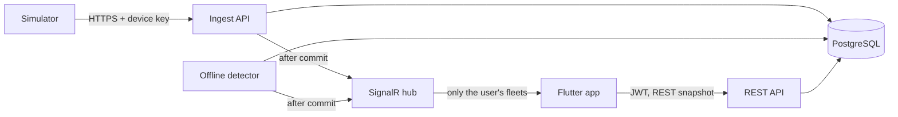

# Technical decisions

The four questions from the assignment, answered briefly. Detailed notes on individual decisions are in the
[appendix](#appendix-detailed-decision-notes).

## 1. What would I ideally clarify?

I would ask these five questions first, because the answers change the design the most.

- **Who can see which vehicles?** Is access per fleet, per vehicle, or per customer? Are there roles other than
  "admin" and "operator"? This decides the permission model. I assumed access per fleet (A1, A2).
- **How do the vehicles send data today?** Which protocol (HTTPS, MQTT, a vendor gateway), how often, and how
  reliable is the network in the field? This decides how ingestion works. I assumed HTTPS with a key per vehicle
  and one sample every few seconds (A3, A8).
- **What does "offline" mean for the team?** After how long without data is a vehicle offline, and should someone be
  alerted? I assumed 30 seconds and no alert (A5).
- **Is the app only for monitoring?** If operators will also send commands (stop, return home), the system needs
  a command channel and an audit log. I assumed monitoring only (A4).
- **How long must history be kept?** Are there retention or privacy rules for location data? This decides how the
  history table grows and when old data is deleted. I assumed it is kept indefinitely (A7).

Smaller questions: Is there an existing login system (SSO) to use? Do operators need push notifications while the
app is closed? Is a delay of a few seconds fine for live updates? Which phones and how many vehicles and users are
expected?
## 2. Assumptions (and why)

Where I did not get an answer, I made these assumptions. Each one is easy to change, and the last column says how.

| # | Assumption | Why | If it's wrong |
|---|---|---|---|
| A1 | Access is per **fleet** | Matches how field teams are organised; one rule to enforce | Replace the `UserFleetAccess` table with per-vehicle access. `IVehicleAccessService` is the only place that changes. |
| A2 | Two roles: Admin sees all, Operator sees assigned fleets. Both are **read-only**. | Simplest model that still shows real access control | Add a permissions table; the access service reads it. |
| A3 | Tens of vehicles, one sample every ~2 s each | A typical small operation, easy to demo | For thousands: batch ingestion, partition telemetry, add a SignalR backplane. |
| A4 | Monitoring only, no commands | The assignment asks for monitoring | Add a command channel (likely MQTT) and an audit log. |
| A5 | A vehicle is offline after **30 s** without data, decided by the server | One rule for every client | Change `Telemetry:OfflineThresholdSeconds`. For alerts, send the existing "went offline" event as a notification. |
| A6 | "Previous activity" = telemetry history + activity events | Covers both "where was it" and "what happened" | Events are one enum with one rule each, so a new type is a small change. |
| A7 | History is kept indefinitely | Fine for a demo | Add a retention job or time-based partitioning. |
| A8 | Vehicles send data over HTTPS with their own key | Simple, testable, works through most networks | Put an MQTT broker in front; the ingestion service behind it stays the same. |
| A9 | No offline cache in the app; it shows clear stale and disconnected states | Monitoring data is only useful when it is current | Cache the last snapshot on the phone and mark it as old. |
| A10 | A vehicle outside your fleets answers **404**, not 403 | Does not reveal that the vehicle exists | Change one line if the client prefers 403. |
| A11 | Login with email and password; the token lasts 60 minutes; no refresh token | Keeps authentication simple for a demo | Use the company's login system (SSO) and refresh tokens. |
## 3. Main components and why

- **One ASP.NET Core API project, organised by feature folders.** The domain is small. Extra projects and layers
  would add indirection without making the code easier to test, because the integration tests already run the real
  HTTP pipeline.
- **PostgreSQL for everything.** Data survives restarts, writes are transactional, and a unique index on
  (vehicle, sequence) makes ingestion idempotent: if a device sends the same sample twice, it is stored once.
- **Latest state on the vehicle row, history in a separate table.** The list and the map read one row per vehicle,
  which is fast. A sample that arrives late goes into the history but does not overwrite the latest state.
- **SignalR for live updates.** Polling wastes requests and is slow. Server-Sent Events only send data one way, so I
  would have to build groups, access control and reconnection myself. MQTT to the phone would need another broker and
  another login system. SignalR uses WebSockets, falls back to other transports, and reconnects.
- **Server-side groups per fleet.** The server decides which fleets a connection receives, using the same access rule
  as the REST API. A client cannot ask for another fleet's updates.
- **Changes are sent to phones only after the database commit.** Phones never see data that could still be rolled
  back. Each vehicle also has a server-set `updatedAt`, and the app keeps the newest copy per vehicle. So a slow REST
  response cannot overwrite a newer live update.
- **The simulator is a separate process.** It calls the same ingest endpoint a real vehicle would. Stopping it shows
  offline detection working.
- **Flutter with Riverpod.** One codebase for iOS and Android, with simple state that is easy to test. It is also the
  framework I know best.

## 4. What I left out or simplified

I kept the scope small on purpose. This is what I left out, and how I would add it with more time.

| Left out | How I would do it |
|---|---|
| Commands to vehicles | A command endpoint and a queue to the devices, with acknowledgements and an audit log |
| Refresh tokens | A short access token plus a rotating refresh token, so the app renews silently instead of logging out after 60 minutes |
| User and fleet management screens | Admin screens, or use the company's login system and its groups |
| Push notifications | FCM/APNs for faults and low battery, triggered by the existing activity events |
| Offline cache in the app | Save the last snapshot on the phone and show it, clearly marked as old |
| Telemetry retention | Time-partitioned tables (or TimescaleDB), downsample old data, delete after N days |
| Running several API instances | A load balancer and a SignalR backplane (e.g. Redis); run migrations as a separate deploy step |
| HTTPS, rate limits, device keys | TLS at a reverse proxy; rate limits per device and per user; keys issued per device and stored in a secret store |
| Map tiles | A commercial or self-hosted tile provider, with the URL in config |

## Known limitations / incomplete

- **Real-time connections keep their groups.** REST checks the user and their current role on every request. A
  real-time connection decides its fleets only when it connects, so a changed role or removed fleet applies after the
  next reconnect. A deleted user's open connection stays open until the token expires (at most 60 minutes), but they
  cannot open a new one.
- **Clock-based states use the phone's clock.** "Stale" and the session timer depend on it. A wrong clock shows
  vehicles as stale too early or too late. The server's Offline status is not affected.
- **iOS keeps stored tokens after the app is uninstalled.** A reinstalled app can start with an old token. The server
  rejects it if the user no longer exists, and the app goes to the login screen.
- **One API instance only.** Startup migrations and seeding would conflict if several instances started together.
- **Tested on simulators and emulators, not on physical phones.** The app allows plain HTTP only for `localhost` and
  the Android emulator address. A real phone needs the API behind HTTPS.
- **No load testing.** The scale numbers in my assumptions (A3) are estimates, not measurements.
---

## Appendix: detailed decision notes

Notes written while building, grouped by area. Decision first, then why.

### Hosting & configuration
- **No HTTPS inside the container.** The API listens on plain HTTP 8080 and has no `UseHttpsRedirection`/HSTS.
  In production TLS is terminated by a reverse proxy / load balancer in front of the API.
- **Compose runs as `Production`, demo features are flags.** `ASPNETCORE_ENVIRONMENT=Production` means no developer
  exception page (no stack traces to clients). Swagger and seeding are turned on with explicit flags
  (`Swagger:Enabled`, `Seed:Enabled`), off by default in `appsettings.json`.
- **Demo secrets in compose.** The JWT signing key, DB password and device keys in `docker-compose.yml` /
  `config/devices.json` are demo-only. Production would use a secret store (e.g. environment from a vault).
- **Fail fast on bad config.** Options are validated at startup (`ValidateOnStart`): e.g. a JWT signing key shorter
  than 32 bytes (HS256 minimum) stops the app instead of issuing weak tokens.
- **`GSS Encryption Mode=Disable` in every connection string.** Npgsql otherwise tries to load the Kerberos library
  (`libgssapi_krb5`), which the `aspnet` image doesn't ship, and logs a harmless but alarming error. We don't use
  Kerberos, so turning it off is cleaner than installing a library we don't need.
- **Postgres published on host port 5433** so `dotnet run` (appsettings.Development) can use the compose database
  without clashing with a local Postgres on 5432.

### Data
- **Migrations at startup** (hosted service, before the server accepts requests). Fine for a single instance.
  With several instances they would race to apply the same migration; production would run migrations as a
  separate deploy step (EF migration bundle / pipeline job). The seeder has the same race: two instances could both
  see "no users" and the second would fail on the unique email index. Seeding would also move to that one-off step
  (and in production there is no demo seed at all).
- **Enums stored as text** so the database is readable without the code.
- **`xmin` as concurrency token on `Vehicle`** (Postgres system column, no extra column).
- **Seeder is idempotent** (skips if any user exists) and writes everything in one `SaveChanges` (one transaction).
- **Entity named `VehicleFleet`**, not `Fleet`: a type named `Fleet` clashes with the root namespace `Fleet`.
  Table and API still say "fleet".
- **Single `config/devices.json`** is the source for both the seeder (stores hashes) and the simulator (sends keys).
- **`config/devices.json` contains demo-only device keys, committed on purpose** so `docker compose up` works from a
  clean clone. In production each device is provisioned individually and keys never live in the repo.

### Auth
- **Device keys hashed with SHA-256 (unique index), not BCrypt.** Device keys are 256-bit random secrets, not
  human passwords, so brute force is not realistic and a slow salted hash adds nothing. A deterministic hash lets
  ingestion find the vehicle from the key with one indexed lookup; a salted hash cannot be looked up, and BCrypt
  would cost ~100 ms on every telemetry sample.
- **User passwords hashed with BCrypt** (work factor 11).
- **Login does not reveal whether an email exists**: same 401 body for both cases, and an unknown email still runs
  one `BCrypt.Verify` against a dummy hash so response time is similar.
- **Email normalized** (trim + lowercase) on login and when stored.
- **JWT claims kept short** (`MapInboundClaims = false`): `sub`, `email`, `role` as in the token.
- **A valid token is not enough: the user must still exist, and the role comes from the database.** After the JWT is
  validated (`OnTokenValidated`), the user is loaded by `sub` (one primary-key query, no tracking). A deleted user gets
  401 on the next request (also a deleted admin, whose token still says "Admin"), and the role claim is replaced with
  the current database role, so promoting/demoting someone applies on their next request without a new login. Cost:
  one primary-key lookup per request and per hub connection. Found by the clean-clone check: a token from an earlier
  database (same demo signing key) was still accepted and returned empty data instead of 401.
- **Fallback authorization policy**: every endpoint requires a logged-in user unless marked `[AllowAnonymous]`
  (login, `/health`, OpenAPI document). A new endpoint can't be exposed by forgetting an attribute.
- **Login rate limit**: built-in ASP.NET Core rate limiter, fixed window per client IP, on `POST /api/auth/login`
  only (`RateLimiting:Login:*`, default 5 per 60 s), 429 as ProblemDetails.
  Behind a reverse proxy the client IP would come from `X-Forwarded-For` (`UseForwardedHeaders` with the proxy
  configured as trusted); without that, every client would share the proxy's IP and one limit.

### Vehicles API
- **Access check lives in one place.** `VehicleQueryService` starts every vehicle query from
  `IVehicleAccessService.ScopeVehicles`; controllers never filter. Out of scope and nonexistent give the same 404
  (A10). A `fleetId` filter is applied *after* scoping, so an out-of-scope fleet returns `200 []` and can't be used
  to probe which fleets exist.
- **One status expression.** `VehicleProjections.ToDto` is the only place the user-facing status is derived. The
  `?status=` filter runs on the projected DTO (EF translates a filter after a member-init projection), so the list and
  the filter can't disagree.
- **Read queries project straight to DTOs** (`AsNoTracking` + `Select`): one SQL statement per request, `fleetName`
  via a join, no `Include`.
- **Telemetry window capped at 7 days** (400 above that) and `limit` clamped to 2000: bounds the cost of one request.
  `limit < 1` is a 400 rather than silently becoming 1.
- **Activity uses keyset pagination with an opaque cursor** over (`OccurredAt`, `Id`), not offset paging (stable while
  new events arrive) and not a bare timestamp (events created in one ingestion share a timestamp and would be skipped
  at page boundaries). The cursor truncates to microseconds, Postgres' `timestamptz` precision, so it compares equal
  to stored values. It is not signed: a modified cursor can only move within the caller's own scoped data, and a
  malformed one is a 400.
- **Timestamps from query strings are converted to UTC** before querying (Npgsql only accepts UTC for `timestamptz`).

### Ingestion & offline detection
- **Duplicates: `INSERT … ON CONFLICT ("VehicleId", "Sequence") DO NOTHING`, not catching error 23505.** A repeated
  sample is a normal event (device retries after a timeout), not an error. With `ON CONFLICT` a duplicate is just
  "0 rows inserted": no exception, Postgres logs no `ERROR` line per duplicate, and the transaction stays usable, so
  the code is a straight line. It is still race-safe (the unique index decides). Cost: one hand-written SQL statement,
  kept in one method and covered by the duplicate tests.
- **Device authentication is its own scheme** (`DeviceKey` authentication handler) next to JWT. User tokens can't
  ingest; device keys can't read user endpoints; the vehicle id comes only from the key.
- **One transaction per sample**, `xmin` as optimistic concurrency token on the vehicle row. On a conflict the whole
  attempt is rolled back, the vehicle is re-read and the attempt is retried once; a second conflict returns 503 and the
  device retries the same sample (idempotent by sequence). Conflicts are rare (one sender per vehicle); the realistic
  source is the offline detector writing the same row.
- **Offline detection vs. ingestion race.** The detector reads stale vehicles, then writes each one with the `xmin` it
  read. If a sample arrived in between, the row changed, the update matches nothing, and that vehicle is skipped:
  it just reported in. Each vehicle is its own `SaveChanges`, so one conflict doesn't undo the others.
- **Offline window 30–35 s**: threshold 30 s, check every 5 s. A shorter interval tightens the window at the cost of
  more queries (one indexed query per pass).
- **Broadcasts only after commit**, never inside the transaction, so clients never see data that might be rolled back.
  The pushed `VehicleDto` is re-read with the same projection as `GET /vehicles/{id}`. A failed broadcast is logged
  and not retried: the data is safe, and clients re-fetch the snapshot on reconnect.
- **Event rules**: `FaultRaised` only when entering Fault (a 20 s fault = 1 event, not 10); no `StateChanged` on the
  first sample (`CameOnline` covers it); `LowBattery` on crossing below 20 %, re-armed after recovering.
- **All event timestamps are server time.** Device clocks drift; one clock keeps the activity order and the cursor
  consistent. The device time is kept in `TelemetryRecord.RecordedAt`.
- **Clock-skew guard**: `recordedAt` more than 5 min in the future is rejected, otherwise a device with a fast clock
  would block newer real samples from becoming the latest state.

### Simulator
- **Separate process calling the real ingest endpoint** with each vehicle's key, so it exercises the same path a real
  vehicle would; stopping it demonstrates offline detection.
- **Sequence starts at the current Unix time in ms**, +1 per sample. A real device keeps its counter in flash; with an
  in-memory counter starting at 1, a restarted simulator would only send duplicates and vehicles would never come back
  Online.
- **Plain `HttpClient` with a manual retry loop** (1, 2, 4, 8, max 10 s) for network errors, 5xx and 429, resending the
  same sample. No resilience library: the logic is ~20 lines and easy to read.
- **Options validated with `Validator.TryValidateObject`** instead of `ValidateDataAnnotations()`, which would need one
  more package in the simulator.
- **`SN-0004` drops out for 45 s every 3 minutes** to show offline detection without touching Docker.

### Logging
- Single-line console logs with timestamps, so `docker compose logs -f` is readable.
- API: per-sample ingestion at Debug; activity events (CameOnline/WentOffline/StateChanged/…) at Information;
  503 after retries at Warning. EF Core and ASP.NET Core framework logs at Warning (migrations at Information).
- Simulator: each send at Debug; startup, state changes, dropout start/end at Information; retries at Warning;
  rejected samples at Error.

### Ordering updates on the client
- **`Vehicle.UpdatedAt` (server time) is the per-vehicle ordering key**, set on every write to the vehicle row
  (ingestion and offline detection) and exposed as `updatedAt` on REST and the hub. `lastTelemetryAt` doesn't work:
  going Offline doesn't change it, and a REST snapshot read *before* the Offline flip but arriving *after* the live
  Offline update would have the same `lastTelemetryAt` and flip the vehicle back to Online.
- **Strictly increasing per vehicle**: truncated to microseconds (Postgres precision, so clients compare exactly what
  is stored) and at least 1 µs after the previous value, even within one microsecond or if the clock steps back.
  The `xmin` token already serializes writers per vehicle, so "previous" is always the committed value.
- Clients keep the copy with the greater `updatedAt` and ignore equal or older ones, for live updates and REST
  snapshots alike.

### Real-time (SignalR hub)
- **Strongly typed hub (`Hub<IFleetClient>`) with no client → server methods.** Group membership is decided in
  `OnConnectedAsync` from `IVehicleAccessService`, the same rule as REST. A client cannot ask to join a fleet, so the
  real-time channel can't leak data across fleets. Group membership is fixed for the life of a connection: access
  changes apply on the next (re)connect, and a deleted user's open connection lasts until token expiry (acceptable
  for the demo; production would remove the user from groups / abort their connections when access is revoked).
  Connecting runs the same user check as REST, so a deleted user can't open a new connection.
- **Sends go to `fleet:{fleetId}` groups only**, through `IHubContext<FleetHub, IFleetClient>` behind
  `IFleetBroadcaster`, after commit.
- **Same JSON settings for REST and SignalR** (`JsonConfiguration.Apply`), so the app parses one `VehicleDto` shape.
- **Hub accepts only the JWT scheme.** Device keys can't connect.
- **`access_token` query parameter accepted only on `/hubs/fleet`.** WebSocket clients can't always set headers; on
  every other path a token in the URL is ignored, so tokens don't spread into URLs.
- **Tokens in the hub URL are not logged.** Checked: ASP.NET Core request logs (which include the query string) are
  at Information, and the `Microsoft.AspNetCore` category is configured at Warning; SignalR/connection/Kestrel logs
  that mention connections are Debug/Trace. After a WebSocket session on compose, the API logs contained no
  `access_token`, `/hubs/` or JWT text. If request logging is ever turned on, the query string must be redacted
  first. A reverse proxy in front would need the same care.
- **`CloseOnAuthenticationExpiration = true`.** Without it an open connection keeps receiving data after the JWT
  expires. It closes at the token's `exp`: JwtBearer copies `exp` into the authentication properties and the
  connection layer checks it about once per second. `ClockSkew` (30 s) only applies when a token is validated, so it
  does not extend an open connection (a test with a 3 s token closes in ~5 s, well under the skew). The app then has
  to log in again (no refresh tokens) and reconnect.
- **Tests use long polling** through the in-memory TestServer (WebSockets there need extra setup). Negotiate, auth,
  groups and the JSON protocol are the same; the compose smoke test covered real WebSockets.

### Mobile app (foundation)
- **Riverpod 3 without code generation**, plain `Notifier`/`AsyncNotifier`/`Provider`. Automatic provider retry is
  turned off: errors are shown with an explicit retry, and retrying a 401/404 only repeats the failure.
- **No router package.** The home screen follows the auth state (login vs. app), so any logout lands on login.
  Revisit if the 5b design needs deep links or nested navigation.
- **One `ApiClient` (dio)** that adds the token and turns every failure into a typed `ApiException` built from the
  server's ProblemDetails. A 401 logs out, **except on `POST /api/auth/login`**, where 401 means wrong credentials and
  429 means rate-limited.
- **Session in secure storage** (Keychain / Android Keystore via `flutter_secure_storage`): token, `expiresAt` and the
  user. The app restores without a network call; an expired token on start goes to login with "session expired",
  and a timer logs out when `expiresAt` passes while the app is open. Relies on the device clock (the server's
  30 s skew covers small drift; a badly wrong clock just causes an earlier/later logout).
- **Unknown enum values never crash**: status, connectivity, state, activity type and role have an explicit `unknown`,
  so a newer API can add values without breaking older app versions.
- **Client-side filtering over the full list**: the list state holds every vehicle the user can see (already scoped by
  the server), filters are a view on top. Live updates can then always be applied by id. Server-side filter params
  are still available in the repository.
- **Ordering by `updatedAt`** (see "Ordering updates on the client"): live updates and REST snapshots both keep the
  strictly newer copy per vehicle. A snapshot decides which vehicles are listed.
- **Cleartext HTTP only for dev hosts**: Android `network_security_config` allows it only for `10.0.2.2` and
  `localhost` (everything else HTTPS-only); iOS uses `NSAllowsLocalNetworking`, which allows plain HTTP to local
  addresses only. A production build would use an HTTPS API and need neither.
- **iOS deployment target 15.0** (template had 13.0, which Xcode 27 rejects).

### Mobile UI (Phase 5b, design in docs/design/)
- **Theme from the design tokens**: Material 3 `ColorScheme` with an ink primary (status colours own the colour
  channel), a `StatusColors` ThemeExtension (foreground + tint per status, incl. stale), the Inter type scale, spacing
  and radius constants. Every status is colour + icon + label, never colour alone.
- **Inter bundled as a font asset** (OFL 1.1, official rsms/inter v4.1 static TTFs) instead of `google_fonts`: no
  runtime download, works offline, and the app doesn't contact Google on start. Tabular figures for all live values.
- **Built-in Material icons** instead of the design's SVG paths: no SVG/path package; close but not identical.
  Map markers are CustomPainter shapes (circle / rounded square / diamond / triangle) so status reads without colour.
- **"Stale" is computed on the client**: online but `lastSeenAt` older than 30 s (the server's offline threshold).
  The server's status stays authoritative; stale only covers the gap before its Offline message arrives. In 5b
  (REST only, no live updates) a snapshot older than 30 s therefore shows as stale until refreshed — intended; Phase 6
  adds live updates and a periodic re-check.
- **Filters on the device over the full scoped list**; the summary counts follow the fleet filter only (status filter
  doesn't change them), as in the design. Sorted Fault → Moving → Idle → Charging → Stale → Offline (reported first),
  then name.
- **Detail reads the vehicle from the shared list state** (falls back to `GET /vehicles/{id}`), so list and detail
  always agree and Phase 6 updates reach both.
- **"Open in map" switches to the app's own Map tab** with the vehicle selected and centred (no external maps app).
  Tapping a marker only selects it (no camera jump); only an external selection moves the camera.
- **History**: the list shows every sample (~1800 per hour) with gap rows where the vehicle was offline (> 30 s
  without samples). The chart is a CustomPainter (no chart package) and plots per-minute averages, because raw 2 s
  samples are too noisy to read; lines break at offline gaps.
- **Rate-limit countdown** from the `Retry-After` header (fallback 60 s). The fixed-window limiter reports the full
  window length, so the countdown is an upper bound, never too short.
- **OSM public tile servers are for the demo only.** Their usage policy doesn't allow heavy or commercial use. The app
  identifies itself (`userAgentPackageName`) and shows the attribution. Production would use a commercial or
  self-hosted tile provider, with the tile URL in configuration.
- **Login validates empty fields on the client** (button disabled until both have text; keyboard submit shows
  "Enter your email/password"), so the server's generic validation message never shows.
- **No app version on Account** (would need `package_info_plus`).
- **Screenshots** in `docs/media/` (iOS simulator full set; Android list, map, login error; Reconnecting and
  Disconnected banners on both platforms).

### Mobile real-time (Phase 6)
- **`RealtimeConnection` interface** over `signalr_netcore`, so the controller is tested with a fake. One connection
  object per attempt: after it closes, a new one is created.
- **Connect the hub first, then fetch the REST snapshot** (and merge it with the `updatedAt` rule) — on start, after
  every automatic reconnect and after resume. Fetching first would lose updates that happen between the snapshot and
  the connection. The app still does a fast first fetch when it opens (to show something immediately); the
  fetch-after-connect is the authoritative one.
- **Reconnect**: the package's automatic reconnect (0, 2, 5, 10, 30 s) after a drop, then our own retry every 30 s
  once the connection has closed (the package doesn't retry a failed first start at all). Banner: nothing while the
  first attempt runs or after an intentional pause; "Reconnecting…" during the automatic reconnect or a manual
  Retry; "Disconnected – paused since HH:mm" + Retry once it closed. The count line shows "Last received HH:mm:ss ·
  may be outdated / not live" in amber while not live.
- **Guards**: one connection attempt at a time; the 30 s loop only after close, never during the automatic
  reconnect; logout and pause cancel the timer and invalidate the connection; every callback checks a generation
  number, so late events from an old or stopped connection are ignored; a refresh started just before logout does
  not fetch afterwards. The old connection is stopped without being awaited, so a slow stop can't delay anything.
- **Session expiry vs. network loss**: if the hub closes and the token is expired (the server closes it at `exp`),
  the app logs out with "session expired" instead of showing Disconnected. On resume the expiry is checked first,
  because timers don't run while the app is suspended.
- **401 on hub connect/reconnect = 401 on REST**: the server no longer accepts the token (e.g. the user was
  deleted), so the app logs out with the same "session" message, stops the automatic reconnect and the 30 s loop,
  and shows no Disconnected banner. Network errors and 5xx keep the Reconnecting/Disconnected + retry behaviour.
  The status code is read on the hub's HTTP client (the negotiate request), because the package wraps errors
  during its automatic reconnect in a plain `Exception` and the `HttpError.statusCode` is lost there; a small
  retry policy then stops the reconnect once a 401 was seen. Matched on the status code, never on message text.
- **Lifecycle**: background → connection and ticker stopped on purpose (no banner, no retries); foreground →
  reconnect, then re-fetch.
- **Live activity**: `ActivityRaised` is added to an open activity feed for that vehicle, deduplicated by event id;
  events arriving while the first page is loading are merged in afterwards. **The History tab doesn't append live**
  (pull to refresh / reopening is enough for a 1-hour history; ~1800 rows would churn constantly).
- **1 s ticker**: only small widgets (`TimeAgoText`, the card's accessibility label) rebuild every second. Screens
  watch the *set of stale vehicles*, which only changes when a vehicle crosses the 30 s line, so the list/map/detail
  don't rebuild every second.
- **Known limitation**: a detail screen opened for a vehicle that is not in the list (only reachable through the
  fallback fetch) doesn't update live; every normal path goes through the shared list.
